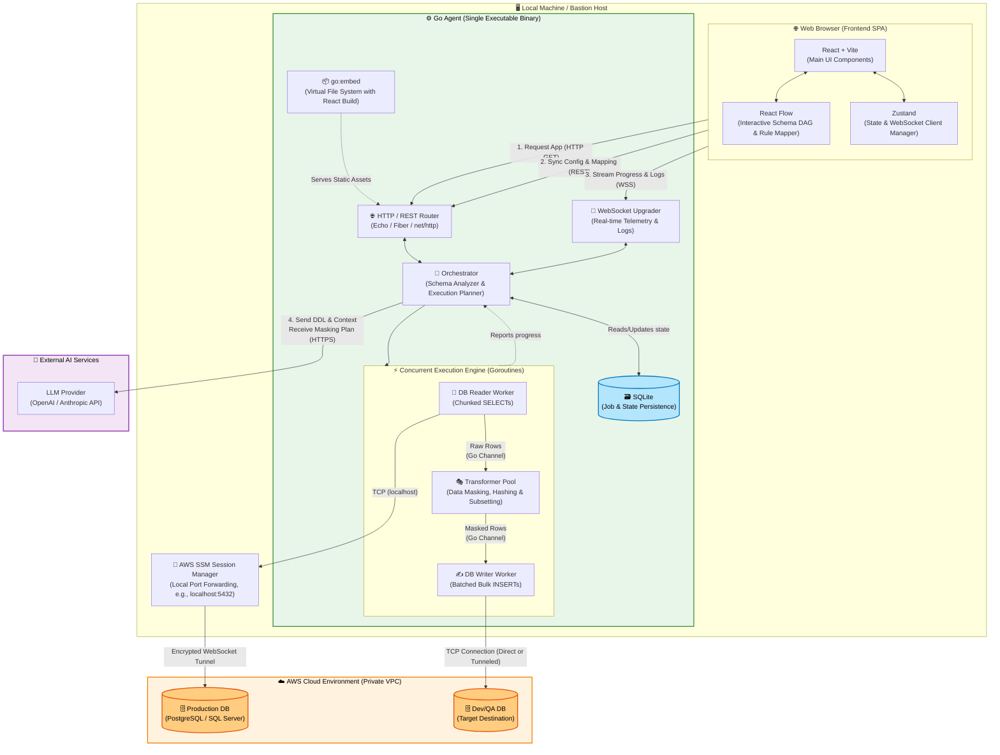

# Stewrd: Multi-Source Data Sync & Masking Agent

  

    

Stewrd is an advanced data synchronization and masking tool migrating records from multiple sources to multiple destinations concurrently. It compiles into a single binary containing a Go backend, React UI, SQLite checkpointing, and SSM/SSH tunnels.

## 📖 Table of Contents
- [Stewrd: Multi-Source Data Sync \& Masking Agent](#stewrd-multi-source-data-sync--masking-agent)
  - [📖 Table of Contents](#-table-of-contents)
  - [🏗️ General Architecture](#️-general-architecture)
  - [✨ Key Features](#-key-features)
  - [📂 Project Structure (Monorepo)](#-project-structure-monorepo)
  - [🚀 Deployment and Execution](#-deployment-and-execution)
    - [Standard Deployment](#standard-deployment)
  - [🛠️ Development Standards \& Commits](#️-development-standards--commits)
  - [⚖️ License](#️-license)

## 🏗️ General Architecture

Stewrd operates as a self-contained agent. The frontend SPA is built with React and Zustand, and it is injected directly into the Go binary using `go:embed` as a Virtual File System.

## ✨ Key Features

*   **Single File Deployment:** The system compiles into a single executable binary, requiring no external web servers like Nginx.
*   **Multiple Connection Methods:** Natively supports Local Port Forwarding via AWS SSM Session Manager, standard SSH tunnels, and direct connections.
*   **Resilient Checkpointing:** Uses a `TABLE_TASK` table in SQLite to track exact row progress, enabling resumption of failed or interrupted tasks without starting over.

## 📂 Project Structure (Monorepo)

The project separates responsibilities strictly based on SOLID principles:

*   `/cmd/stewrd`: Entry point that initializes configuration, server, and engine.
*   `/internal/server`: HTTP layer (REST) and WebSocket Upgrader for telemetry.
*   `/internal/engine`: The core engine, divided into `connection`, `executor` (Workers), and `orchestrator`.
*   `/internal/errors` & `/internal/logger`: Standardized `AppError` and structured telemetry.
*   `/internal/helpers`: Pure, transversal utility functions.
*   `/frontend`: React SPA folder. Strictly organized into `components` (visual) and `containers` (logic/state), alongside a `constants` folder.

## 🚀 Deployment and Execution

### Standard Deployment
Deploying Stewrd requires only two files:
1.  The Go compiled binary.
2.  The `appsettings.yaml` configuration file.

## 🛠️ Development Standards & Commits

To maintain code quality, the project strictly enforces the following rules:

*   **Frontend SOLID & DRY Rules:** Absolute prohibition of duplicated code. All logic must use strictly typed TypeScript interfaces. Avoid hardcoded strings by extracting them into constant files. Use `extends` in interfaces whenever possible.
*   **Conventional Commits:** Every commit must follow the structure: `type(scope): description`.
    *   **Types:** `feat`, `fix`, `refactor`, `perf`, `test`, `chore`, `docs`.
    *   **Scopes:** `frontend` (React UI), `engine` (Go Orchestrator/Workers), `server` (HTTP/WebSockets), `db` (SQLite/JobDB), `config` (YAML mapping).
    *   *Example:* `feat(engine): add ssh tunnel support for mysql connections`

## ⚖️ License

**Source-Available (Non-Commercial Use)**.
This project is licensed under the **PolyForm Noncommercial License 1.0.0**. The source code is open for reading, auditing, and educational use; however, **any commercial use is strictly prohibited**. It may not be sold, monetized, or integrated into paid SaaS products by third parties.
